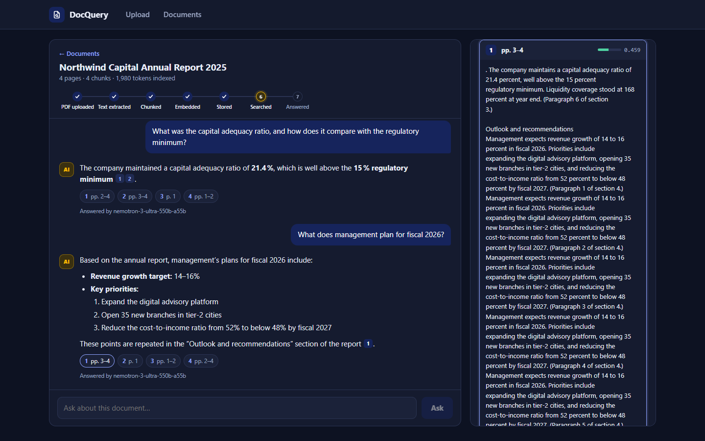
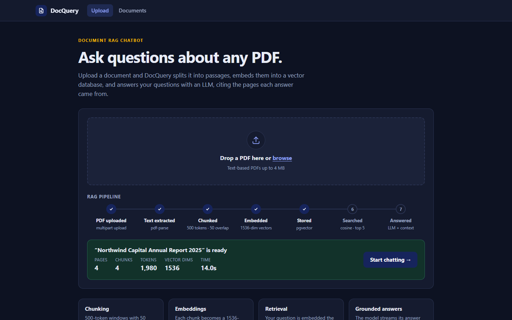
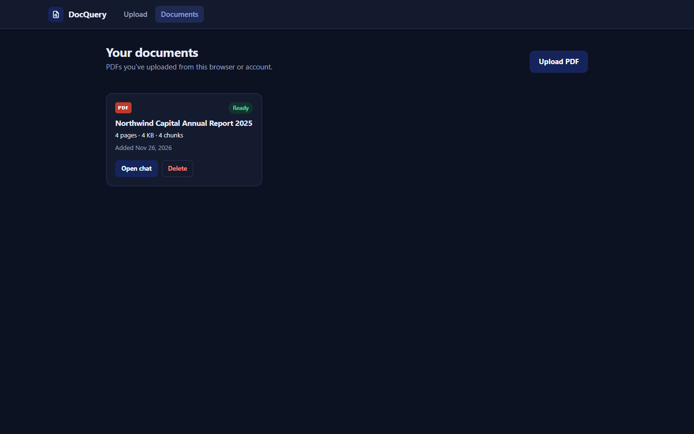
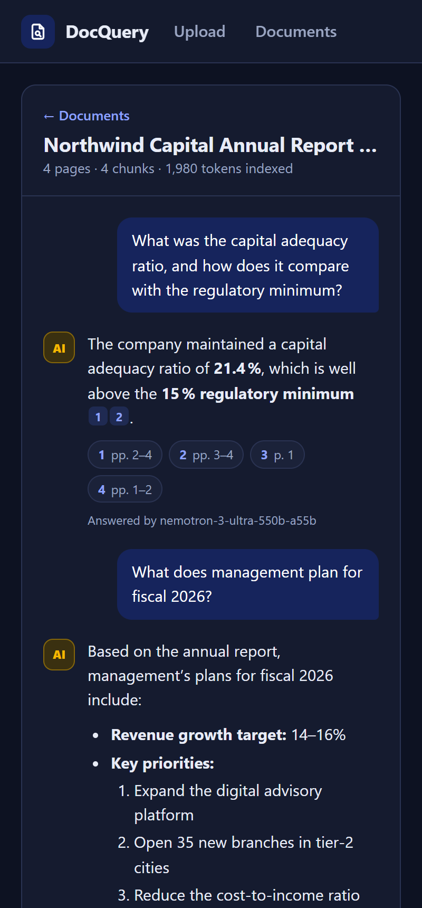

# FinTask RAG Chatbot (DocQuery)

[](https://fintask-ragchatbot.vercel.app)
[](https://github.com/astaboyyye/fintask-ragchatbot/releases)

**Project 3: AI Chatbot with Document RAG.** Upload a PDF and ask questions about it. The app extracts the
text with **pdf-parse**, splits it into **500-token chunks with a 50-token overlap**, creates **embeddings**
(OpenAI `text-embedding-3-small`, 1536 dims), stores them in Postgres with **pgvector**, retrieves the
**top 5 chunks by cosine similarity**, and streams a **Claude** answer over **Server-Sent Events** with
**source citations** (passage number, page range, similarity score).

**Live:** https://fintask-ragchatbot.vercel.app · **Sample PDF:** [`public/sample/northwind-annual-report-2025.pdf`](public/sample/northwind-annual-report-2025.pdf)



## Requirements checklist

Every stage of the pipeline, with the code that implements it.

| # | Requirement | Implementation |
|---|---|---|
| 1 | **PDF upload** | `lib/pdf.js` `readPdfUpload()` (multipart via formidable, 4 MB cap) · `pages/api/upload.js` · `components/PdfUploader.jsx` (drag and drop) |
| 2 | **Text extraction (pdf-parse)** | `lib/pdf.js` `extractPdf()`: per-page text with pdf-parse v2; rejects non-PDFs, password-protected, damaged, image-only and >500-page files |
| 3 | **Chunking: 500 tokens, 50 overlap** | `lib/chunker.js` `chunkPages()`: `cl100k_base` tokens, sliding window, page range per chunk |
| 4 | **Embeddings (OpenAI)** | `lib/embedder.js` `embedTexts()`: `openai.embeddings.create({ model: "text-embedding-3-small", dimensions: 1536 })`, batches of 96 |
| 5 | **Stored in pgvector** | `prisma/schema.prisma` `vector(1536)` column · `prisma/migrations/0001_init` `CREATE EXTENSION vector` · insert in `pages/api/process.js` |
| 6 | **Vector similarity: cosine, top 5** | `lib/vectorSearch.js` `searchChunks()`: `ORDER BY embedding <=> $query::vector LIMIT 5`, similarity `1 - distance` |
| 7 | **Claude + context** | `lib/claudeRAG.js` `streamAnswer()`: `@anthropic-ai/sdk` `messages.stream()` with `claude-opus-5-5`; passages sent as numbered `<source>` blocks |
| 8 | **Streaming response: SSE** | `lib/sse.js` `openEventStream()` (`text/event-stream`) · `pages/api/chat.js` streams `sources` → `delta`… → `done` · read in `utils/client.js` `streamChat()` |
| 9 | **Source citations** | Model cites `[n]`; `components/ChatMessage.jsx` renders clickable badges; `components/ChunkSourceList.jsx` shows each passage with page range and cosine score |

### The core of it, in code (simplified excerpts)

```js
// lib/chunker.js: 500-token windows that overlap by 50 tokens
const step = chunkSize - overlap;               // 500 - 50 = 450
for (let start = 0; start < tokens.length; start += step) {
  const end = Math.min(start + chunkSize, tokens.length);
  chunks.push({ content: enc.decode(tokens.slice(start, end)), pageStart: tokenPage[start], pageEnd: tokenPage[end - 1] });
}

// lib/embedder.js: OpenAI embeddings, 96 chunks per request
const res = await openai.embeddings.create({ model: "text-embedding-3-small", input: batch, dimensions: 1536 });

// lib/vectorSearch.js: cosine similarity search in pgvector, top 5
SELECT "content", "pageStart", "pageEnd", 1 - ("embedding" <=> ${vector}::vector) AS "similarity"
FROM "Chunk" WHERE "documentId" = ${documentId}
ORDER BY "embedding" <=> ${vector}::vector LIMIT 5

// lib/claudeRAG.js: Claude answers from the retrieved context, streamed
anthropic.messages.stream({ model: "claude-opus-5-5", system: SYSTEM_PROMPT,
  messages: [...history, { role: "user", content: `<sources>${buildContext(chunks)}</sources>\n\nQuestion: ${question}` }] });

// lib/sse.js + pages/api/chat.js: Server-Sent Events to the browser
res.writeHead(200, { "Content-Type": "text/event-stream", "Cache-Control": "no-cache, no-transform" });
send("sources", sources);                       // the cited passages first
for await (const event of stream) if (event.delta?.type === "text_delta") send("delta", { text: event.delta.text });
send("done", { messageId, model });
```

## Try it in two minutes

1. Open https://fintask-ragchatbot.vercel.app and drop in any text-based PDF up to 4 MB (or the sample above).
2. Watch the 7-step pipeline complete, then click **Start chatting**.
3. Ask *"What was the capital adequacy ratio?"*, then click a citation badge to see the exact passage, its pages and its similarity score.
4. Ask something the document doesn't cover: the app says so instead of guessing.

| Upload and pipeline | Document library | Phone |
|---|---|---|
|  |  |  |

## Retrieval quality and safety

- **Relevance threshold.** Of the top 5 chunks, only those with cosine similarity ≥ `MIN_SIMILARITY` (default 0.2) reach the model. If none do, the app replies that the document doesn't cover the question, without calling the model, so it can't answer from loosely related text. The value was measured on this app's embedding models: passages that answer a question score about 0.3–0.6, unrelated text about 0.05–0.15. (Absolute cosine values depend on the model, so a fixed 0.7 would reject almost every correct match.)
- **Context cap.** Retrieved text sent to the model is capped at `MAX_CONTEXT_TOKENS` (default 3,000), keeping the best-ranked chunks.
- **Follow-up questions.** Short follow-ups ("and next year?") are embedded together with the previous question, so retrieval still finds the right passages; the last 8 chat turns go to the model as history.
- **Grounding.** The system prompt requires answers from the passages, `[n]` citations, and an explicit "not covered" instead of outside knowledge.
- **Embedding cache.** Each upload is hashed (SHA-256). Re-uploading the same PDF reuses its stored chunks and vectors instead of paying for embeddings again.
- **Server-side PDF validation.** `%PDF-` signature, 4 MB size limit, password-protected, damaged and image-only PDFs, and a 500-page limit, each with a clear message.
- **Model-safe indexes.** Each document records the embedding model that indexed it; if the model changes, the app asks for a re-index instead of comparing incompatible vectors.
- **Overlap.** 50 tokens is the assignment's specification. `CHUNK_SIZE` and `CHUNK_OVERLAP` are configurable (for example `CHUNK_OVERLAP=100` for dense documents).

## Models and keys

`lib/providers.js` chooses the APIs from the keys that are set:

| Keys set | Embeddings | Answers |
|---|---|---|
| `ANTHROPIC_API_KEY` + `OPENAI_API_KEY` | OpenAI `text-embedding-3-small` | Claude `claude-opus-5-5` (direct, with server-side fallback) |
| `OPENROUTER_API_KEY` + `LLM_MODELS="anthropic/claude-opus-5.5"` | free NVIDIA Nemotron embeddings | Claude Opus 5.5 through OpenRouter |
| `OPENROUTER_API_KEY` only (zero-cost setup used by the live demo) | `nvidia/nemotron-3.5-embed-8b:free` (1536 dims) | free `nvidia/nemotron-3-ultra-550b-a55b`, then other free models if one is busy |

Answers always go through the official Anthropic SDK (`@anthropic-ai/sdk`); OpenRouter offers an
Anthropic-compatible Messages endpoint, so only the base URL changes. Every answer in the UI shows which
model wrote it. Free models allow about 50 requests a day, and each question uses 2.

## Run it locally

Requirements: Node.js 24, Postgres with the `vector` extension (a free [Neon](https://neon.tech) project works),
and API keys (see above).

```bash
npm install
cp .env.example .env          # DATABASE_URL and API key(s)
npx prisma migrate deploy     # tables + pgvector
npm run dev                   # http://localhost:3000
npm test                      # 20 tests: chunking, PDF validation, retrieval, citations, providers
```

**Deploy to Vercel:** import the repo, add `DATABASE_URL` and the API key(s), and deploy. The `vercel-build`
script runs `prisma generate`, `prisma migrate deploy` and `next build`.

## API

| Method and path | Body | Returns |
|---|---|---|
| `POST /api/upload` | multipart `file` | `{ document, duplicate, timings }`: steps 1-2 |
| `POST /api/process` | `{ documentId }` | `{ document, stats, timings }`: steps 3-5 |
| `POST /api/chat` | `{ documentId, question }` | SSE: `sources`, `delta`…, `done` or `error`: steps 6-7 |
| `GET /api/documents` · `GET`/`DELETE /api/documents/:id` | | the visitor's documents, one document with its chat history, delete |

## Project structure

```
lib/          the RAG pipeline: pdf, chunker, embedder, vectorSearch, claudeRAG, sse, providers, db
pages/        index (upload), documents, chat/[docId], api/{upload,process,chat,documents}
components/   PdfUploader, PipelineSteps, ChatMessage, ChunkSourceList, DocumentCard, Layout
utils/        request helpers, visitor identity, optional GitHub sign-in, browser helpers
prisma/       schema.prisma, migrations/      sql/  enable-pgvector.sql
tests/        node:test suites                public/  screenshots, sample PDF
```

Each visitor gets a private workspace (httpOnly cookie, or GitHub sign-in when configured), chat history
is saved per document, and documents can be re-processed or deleted (chunks and messages cascade).

## License

[MIT](LICENSE)
