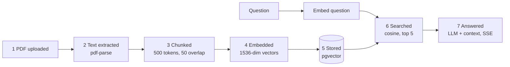

# FinTask RAG Chatbot (DocQuery)

[](https://fintask-ragchatbot.vercel.app)
[](https://github.com/astaboyyye/fintask-ragchatbot/releases)

**Project 3: AI Chatbot with Document RAG.** Upload a PDF, then ask questions about it. The app extracts
the text, splits it into overlapping token chunks, embeds each chunk into Postgres with **pgvector**,
retrieves the 5 chunks most similar to your question by **cosine similarity**, and has an LLM stream a
grounded answer over **Server-Sent Events**, citing the passages (with page numbers) it used.

**Live:** https://fintask-ragchatbot.vercel.app


## Try it in two minutes

1. Open https://fintask-ragchatbot.vercel.app
2. Upload any text-based PDF up to 4 MB (or use [`docs/sample/northwind-annual-report-2025.pdf`](docs/sample/northwind-annual-report-2025.pdf)).
3. Watch the 7-step pipeline complete, then click **Start chatting**.
4. Ask, for example, *"What was the capital adequacy ratio?"* Click a citation badge such as `1` to see the exact passage, its page range and its similarity score.

| Upload and pipeline | Document library | Phone |
|---|---|---|
|  |  |  |

## The RAG pipeline



| Step | What happens | Where |
|---|---|---|
| 1. PDF uploaded | Multipart upload (max 4 MB, checked for the `%PDF-` signature) | `pages/api/upload.js`, `components/PdfUploader.jsx` |
| 2. Text extracted | pdf-parse v2 (current pdf.js) extracts text **per page**; null bytes are stripped for Postgres | `lib/pdf.js` |
| 3. Chunked | Tokenized with `cl100k_base`, 500-token windows with a 50-token overlap; each chunk records the page range it spans | `lib/chunker.js` |
| 4. Embedded | 1536-dimension vectors, batched 96 chunks per request | `lib/embedder.js` |
| 5. Stored | Chunks and vectors inserted into a `vector(1536)` column in one transaction | `pages/api/process.js`, `prisma/schema.prisma` |
| 6. Searched | The question is embedded with the same model and ranked with pgvector's `<=>` cosine distance; top 5 kept | `lib/vectorSearch.js` |
| 7. Answered | The LLM gets the 5 passages as numbered `<source>` blocks and streams an answer citing them as `[n]` | `lib/claudeRAG.js`, `pages/api/chat.js` |

### Core concepts

- **Chunking: 500 tokens, 50 overlap.** The overlap means a sentence cut at a chunk boundary still appears whole in one of the two chunks. Chunks are measured in real tokens rather than characters.
- **Embeddings.** Each chunk becomes a 1536-dimension vector, and questions are embedded with the same model so they share one vector space. Each document records the model that indexed it; if the model changes, the app asks for a re-index instead of comparing incompatible vectors.
- **Vector similarity: cosine search.** `1 - (embedding <=> query)` is the cosine similarity. The score of every retrieved passage is shown in the UI.
- **Context window: top 5 chunks.** Only the 5 best passages (about 2,500 tokens) go to the model, together with the last few chat turns so follow-up questions work.
- **Streaming response: SSE.** `/api/chat` answers with `text/event-stream`: a `sources` event, then `delta` events as the model writes, then `done` (or `error`).
- **Source citations.** The model must cite passage ids like `[2]`. The UI turns them into clickable badges that open the passage with its page range and similarity score, and every answer shows which model wrote it.

## Choosing models

`lib/providers.js` picks the APIs from the keys that are set. All answer models are called through the
official Anthropic SDK; OpenRouter exposes an Anthropic-compatible Messages endpoint, so only the base URL changes.

| Keys set | Embeddings | Answers | Cost |
|---|---|---|---|
| `OPENROUTER_API_KEY` only (live demo) | `nvidia/nemotron-3.5-embed-8b:free` | `nvidia/nemotron-3-ultra-550b-a55b:free`, then other free models if one is busy | Free; OpenRouter allows 50 free-model requests a day without credits, and each question uses 2 |
| `OPENROUTER_API_KEY` + `LLM_MODELS="anthropic/claude-opus-5.5"` | free Nemotron | Claude Opus 5.5 through OpenRouter | Needs OpenRouter credits |
| `ANTHROPIC_API_KEY` + `OPENAI_API_KEY` | OpenAI `text-embedding-3-small` | `claude-opus-5-5` directly, with server-side model fallback | Paid per use |

When a free model is rate-limited or down before it starts answering, the chat route moves on to the next
model in the list.

## Features

- Drag-and-drop upload with a live 7-step pipeline tracker
- Per-document chat: streaming answers, Markdown, citation badges and a "Retrieved passages" panel
- Chat history saved per document and used for follow-up questions
- Document library: status, page and chunk counts, re-process or re-index, delete (chunks and messages cascade)
- Private by default: each browser gets its own anonymous workspace (httpOnly cookie); optional GitHub sign-in through NextAuth
- Clear errors at every step: non-PDFs, scanned PDFs without a text layer, files over 4 MB, missing keys, rate limits, refusals, and client disconnects (generation is aborted)
- Responsive layout with light and dark themes

## Run it locally

Requirements: Node.js 24, a Postgres database with the `vector` extension (a free [Neon](https://neon.tech)
project works), and a free [OpenRouter](https://openrouter.ai) key (or an Anthropic key plus an OpenAI key).

```bash
npm install
cp .env.example .env          # fill in DATABASE_URL and the API key(s)
npx prisma migrate deploy     # creates the tables and enables pgvector
npm run dev                   # http://localhost:3000
```

Tests (chunking and overlap, citation linking, provider selection):

```bash
npm test
```

## Deploy to Vercel

1. Import the repository in Vercel.
2. Add the environment variables from `.env.example`: `DATABASE_URL`, plus `OPENROUTER_API_KEY` (or `ANTHROPIC_API_KEY` and `OPENAI_API_KEY`).
3. Deploy. The `vercel-build` script runs `prisma generate`, then `prisma migrate deploy`, then `next build`, so the schema is applied on every deploy.

Vercel limits request bodies to 4.5 MB, which is why uploads are capped at 4 MB.

## Environment variables

| Variable | Required | Purpose |
|---|---|---|
| `DATABASE_URL` | yes | Postgres connection string (pgvector must be available) |
| `OPENROUTER_API_KEY` | one of these | Answers **and** embeddings through OpenRouter, free models by default. An `sk-or-` key in `ANTHROPIC_API_KEY` is also recognised |
| `ANTHROPIC_API_KEY` | one of these | Claude directly, for answers; takes priority over OpenRouter |
| `OPENAI_API_KEY` | one of these | Embeddings directly; takes priority over OpenRouter |
| `LLM_MODELS` | no | Comma-separated answer models, tried in order |
| `CLAUDE_EFFORT` | no | Effort for Claude models: `low` (default, fastest), `medium` or `high` |
| `EMBEDDING_MODEL` | no | Override the embedding model (must return 1536 dims); changing it means re-indexing documents |
| `NEXTAUTH_SECRET`, `NEXTAUTH_URL`, `GITHUB_ID`, `GITHUB_SECRET` | no | Turn on GitHub sign-in |

## API

| Method and path | Body | Returns |
|---|---|---|
| `POST /api/upload` | multipart `file` | `{ document, timings }`: text extracted, status `UPLOADED` |
| `POST /api/process` | `{ documentId }` | `{ document, stats, timings }`: chunked, embedded, stored, status `READY` |
| `POST /api/chat` | `{ documentId, question }` | SSE stream: `sources`, `delta`*, `reset`?, `done` or `error` |
| `GET /api/documents` | | `{ documents }` for the current visitor |
| `GET /api/documents/:id` | | `{ document, messages }` |
| `DELETE /api/documents/:id` | | `204` |

## Design notes

- **Exact search, scoped per document.** Retrieval filters to one document, so Postgres uses the `(documentId, index)` index and ranks that document's chunks exactly. An approximate HNSW index combined with a `WHERE` filter can return fewer than 5 rows; it only pays off for search across many documents (see `sql/enable-pgvector.sql`).
- **Page-aware chunks.** Text is extracted page by page and every token keeps its page number, so a citation can say "pp. 4–5" even when a chunk crosses a page break.
- **Grounding.** The system prompt tells the model to answer from the retrieved passages, cite them, and say when the document doesn't cover the question rather than guess.
- **Two-request ingestion.** Upload + extract and chunk + embed + store are separate requests, so each stays well inside serverless time limits and a failed embedding run can be retried without re-uploading.

## Project structure

```
components/   ChatMessage, ChunkSourceList, DocumentCard, Layout, PdfUploader, PipelineSteps
lib/          pdf, chunker, embedder, vectorSearch, claudeRAG, providers, citations, db, owner, auth, client
pages/        index (upload), documents, chat/[docId], api/*
prisma/       schema.prisma, migrations/
sql/          enable-pgvector.sql
tests/        chunker, citations, providers
docs/         screenshots, sample PDF
```

## License

[MIT](LICENSE)
