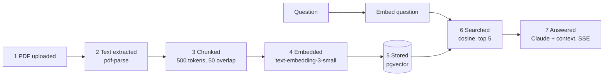

# DocQuery: AI chatbot with document RAG

Upload a PDF, then ask questions about it. DocQuery extracts the text, splits it into overlapping
token chunks, embeds each chunk into Postgres with **pgvector**, retrieves the 5 chunks most similar to
your question by **cosine similarity**, and has **Claude** stream a grounded answer over
**Server-Sent Events**, citing the passages (with page numbers) it used.

Built with Next.js (pages router), Prisma + PostgreSQL/pgvector, OpenAI embeddings and the Anthropic SDK (directly or through OpenRouter).

## The RAG pipeline



| Step | What happens | Where |
|---|---|---|
| 1. PDF uploaded | Multipart upload (max 4 MB, checked for the `%PDF-` signature) | `pages/api/upload.js`, `components/PdfUploader.jsx` |
| 2. Text extracted | pdf-parse v2 (current pdf.js) extracts text **per page**; null bytes are stripped for Postgres | `lib/pdf.js` |
| 3. Chunked | Tokenized with `cl100k_base` (the embedding model's tokenizer), 500-token windows with a 50-token overlap; each chunk records the page range it spans | `lib/chunker.js` |
| 4. Embedded | OpenAI `text-embedding-3-small`, 1536 dimensions, batched 96 chunks per request | `lib/embedder.js` |
| 5. Stored | Chunks and vectors inserted into a `vector(1536)` column in one transaction | `pages/api/process.js`, `prisma/schema.prisma` |
| 6. Searched | The question is embedded the same way and ranked with pgvector's `<=>` cosine distance; top 5 kept | `lib/vectorSearch.js` |
| 7. Answered | Claude gets the 5 passages as numbered `<source>` blocks and streams an answer citing them as `[n]` | `lib/claudeRAG.js`, `pages/api/chat.js` |

### Core concepts

- **Chunking: 500 tokens, 50 overlap.** The overlap means a sentence cut at a chunk boundary still appears whole in one of the two chunks. Chunks are measured in real tokens rather than characters, so they line up with what the embedding model sees.
- **Embeddings: text-embedding-3.** Each chunk becomes a 1536-dimension vector. Questions are embedded with the same model, so they live in the same vector space.
- **Vector similarity: cosine search.** `1 - (embedding <=> query)` is the cosine similarity. The score of every retrieved passage is shown in the UI.
- **Context window: top 5 chunks.** Only the 5 best passages (about 2,500 tokens) go to Claude, together with the last few chat turns for follow-up questions.
- **Streaming response: SSE.** `/api/chat` answers with `text/event-stream` and sends `sources`, then `delta` events as Claude generates, then `done` (or `error`).
- **Source citations.** Claude is told to cite passage ids like `[2]`. The UI turns them into clickable badges that open the passage, its page range and its similarity score.

## Features

- Drag-and-drop upload with a live 7-step pipeline tracker
- Chat per document with streaming answers, Markdown rendering, citation badges and a "Retrieved passages" panel
- Chat history saved per document and used as context for follow-up questions
- Document library: status, page/chunk counts, re-process, delete (chunks and messages cascade)
- Private by default: each browser gets an anonymous workspace (httpOnly cookie). Optional GitHub sign-in through NextAuth
- Errors handled at each step: non-PDFs, scanned PDFs with no text layer, oversized files, missing API keys, rate limits, model refusals, client disconnects (generation is aborted)

## Run it locally

Requirements: Node.js 20.16+ (or 22.3+), a Postgres database with the `vector` extension
(a free [Neon](https://neon.tech) project works), and either one [OpenRouter](https://openrouter.ai) key
or an Anthropic key plus an OpenAI key.

```bash
npm install
cp .env.example .env          # fill in DATABASE_URL and the API key(s)
npx prisma migrate deploy     # creates the tables and enables pgvector
npm run dev                   # http://localhost:3000
```

Run the unit tests (chunking and overlap logic):

```bash
npm test
```

## Deploy to Vercel

1. Push this repo to GitHub and import it in Vercel.
2. Add the environment variables from `.env.example` (at minimum `DATABASE_URL` and `OPENROUTER_API_KEY`, or `ANTHROPIC_API_KEY` + `OPENAI_API_KEY`).
3. Deploy. The `vercel-build` script runs `prisma generate`, then `prisma migrate deploy`, then `next build`, so the database schema is applied on every deploy.

Vercel limits request bodies to 4.5 MB, which is why uploads are capped at 4 MB.

## Environment variables

| Variable | Required | Purpose |
|---|---|---|
| `DATABASE_URL` | yes | Postgres connection string (pgvector must be available) |
| `OPENROUTER_API_KEY` | one of these | Claude (through OpenRouter's Anthropic-compatible endpoint) **and** embeddings (`openai/text-embedding-3-small`). An `sk-or-` key in `ANTHROPIC_API_KEY` is also recognised |
| `ANTHROPIC_API_KEY` | one of these | Claude directly, for answers; takes priority over OpenRouter |
| `OPENAI_API_KEY` | one of these | Embeddings directly; takes priority over OpenRouter |
| `CLAUDE_MODEL` | no | Defaults to `claude-opus-5-5` (direct) or `anthropic/claude-opus-5.5` (OpenRouter) |
| `CLAUDE_EFFORT` | no | `low` (default, fastest), `medium` or `high` |
| `EMBEDDING_MODEL` | no | Defaults to `text-embedding-3-small` (must return 1536 dims) |
| `NEXTAUTH_SECRET`, `NEXTAUTH_URL`, `GITHUB_ID`, `GITHUB_SECRET` | no | Turn on GitHub sign-in |

## API

| Method & path | Body | Returns |
|---|---|---|
| `POST /api/upload` | multipart `file` | `{ document, timings }`: text extracted, status `UPLOADED` |
| `POST /api/process` | `{ documentId }` | `{ document, stats, timings }`: chunked, embedded, stored, status `READY` |
| `POST /api/chat` | `{ documentId, question }` | SSE stream: `sources`, `delta`*, `reset`?, `done` or `error` |
| `GET /api/documents` | | `{ documents }` for the current user |
| `GET /api/documents/:id` | | `{ document, messages }` |
| `DELETE /api/documents/:id` | | `204` |

## Design notes

- **Exact search, scoped per document.** Retrieval filters to one document, so Postgres uses the `(documentId, index)` index and ranks that document's chunks exactly. An approximate HNSW index combined with a `WHERE` filter can return fewer than 5 rows. HNSW is only worth adding for search across many documents (see `sql/enable-pgvector.sql`).
- **Page-aware chunks.** Text is extracted page by page and every token keeps its page number, so a citation can say "pp. 4–5" even when a chunk crosses a page break.
- **Grounding.** The system prompt tells Claude to answer from the retrieved passages, cite them, and say when the document doesn't cover the question rather than guess.
- **Providers.** `lib/providers.js` picks the endpoints from the keys present: direct Anthropic/OpenAI keys, or a single OpenRouter key for both. The code always uses the official Anthropic SDK for Claude; with OpenRouter it only changes the base URL.
- **Model fallback.** On the direct Anthropic API, requests opt into server-side fallback (`fallbacks: "default"`). If the primary model declines mid-answer, the client gets a `reset` event and the fallback model's answer replaces the partial text. OpenRouter doesn't accept this parameter, so it isn't sent there.
- **Two-request ingestion.** Upload + extract and chunk + embed + store are separate requests. Each step stays well inside serverless time limits, and a failed embedding run can be retried without re-uploading.

## Project structure

```
components/   ChatMessage, ChunkSourceList, DocumentCard, Layout, PdfUploader, PipelineSteps
lib/          pdf, chunker, embedder, vectorSearch, claudeRAG, providers, db, owner, auth, client
pages/        index (upload), documents, chat/[docId], api/*
prisma/       schema.prisma, migrations/
sql/          enable-pgvector.sql
tests/        chunker.test.mjs
```
